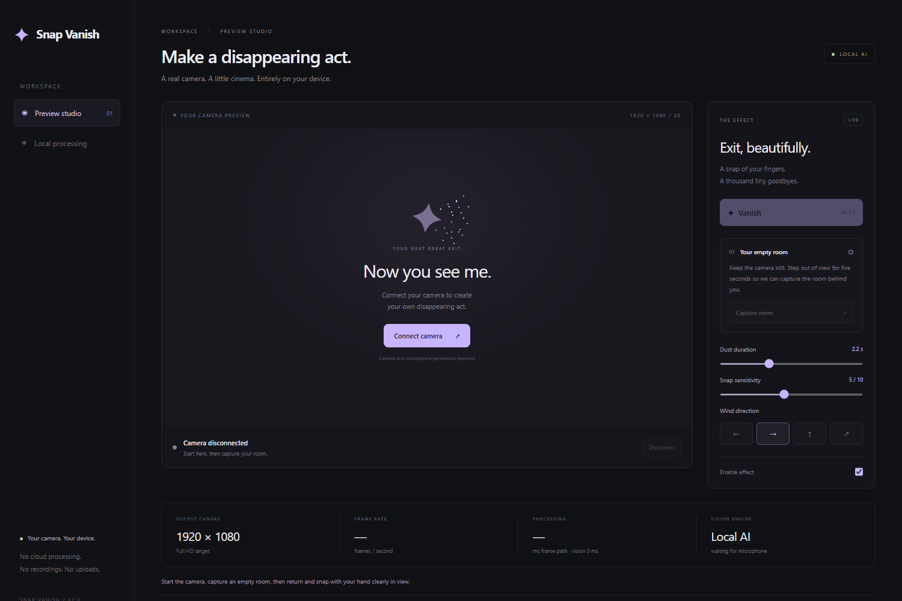

<p align="center"></p>
<h1 align="center">Snap Vanish</h1>
<p align="center"><strong>A snap of your fingers. A cinematic exit.</strong></p>
<p align="center">Local AI hand tracking · GPU dust particles · 1080p output · Brave / Chrome / Edge</p>

Snap Vanish transforms your outgoing browser camera into a dust disintegration effect and restores you on the next snap. It combines real hand landmarks with microphone click confirmation, gates outgoing audio while you are vanished, and keeps processing on your device.



**Current release: 2.0.0.** The output targets 1920 × 1080 at 30 fps. A real empty-room capture is required; generative inpainting, zero latency, and universal calling-site compatibility are not claimed.

[Install](#install-in-brave-no-build-required) · [Controls](#controls) · [Performance](#quality-and-performance-what-is-actually-implemented) · [Architecture](docs/architecture.md) · [Contributing](CONTRIBUTING.md)

## Features

- Fine particles sampled from your camera image, with reversible disintegration and four wind directions.
- Local person segmentation and 21-point hand landmarks using bundled MediaPipe models.
- A visual snap gesture plus a recent microphone click; neither signal alone triggers the effect.
- Automatic outgoing microphone gating that preserves a previously muted state.
- Preview studio, popup, in-call controls, keyboard shortcuts, and live performance diagnostics.
- Packaged runtime and models, with no runtime CDN or cloud processing dependency.

## Install in Brave (no build required)

1. Download this repository using **Code → Download ZIP** and extract it into a permanent folder, or clone it with `git clone https://github.com/satvikpandurangi/snap-vanish.git`. No build is required.
2. Open **brave://extensions**, enable **Developer mode**, choose **Load unpacked**, and select the extracted folder containing `manifest.json`. The selected folder must contain `manifest.json`, `engine/`, `vendor/`, and `models/`.
3. Pin Snap Vanish in the browser toolbar. Reload any calling tabs that were already open. Allow the extension access to the calling site if Brave asks.
4. Open the popup, leave the extension on, and choose **Open preview studio**. Connect the camera and allow camera/microphone permission.
5. Choose **Capture room**. Step completely out of the camera view for five seconds, keeping the camera still. A person still in view causes capture to be rejected. Return to your seat when capture succeeds.
6. Click **Vanish** to verify the effect, then **Reappear**. For automatic triggering, hold your snapping hand clearly in view: touch your middle finger to your thumb, hold briefly, then snap audibly. Both the landmark motion and a microphone transient are required.
7. Disconnect the studio camera before joining your call. On the calling page, capture the room once again using the small Snap Vanish panel. Room plates are held only in the current camera session, never saved.

Chrome: `chrome://extensions`. Edge: `edge://extensions`. Shortcut settings are at `brave://extensions/shortcuts` (or your browser equivalent).

## Controls

- **Vanish / Reappear:** popup button, in-page panel, studio button, or **Alt+Shift+S**.
- **Capture room:** five second countdown, or **Alt+Shift+R**. Move fully out of view, including hands. Recapture whenever the camera, lighting, or room layout changes.
- **Sensitivity:** adjusts pinch, movement, and click thresholds. Audio confirmation is required at every sensitivity.
- **Duration:** 0.8–5 seconds. **Wind:** left, right, up, or scatter.
- **Off:** restores the live camera and the microphone's prior state. If the extension was off when the site opened its camera, enable it and restart that site's camera or reload the tab.

## Quality and performance: what is actually implemented

- The outgoing canvas is **1920 × 1080**, with a **30 fps target**. Camera requests prefer 1080p and 30 fps while preserving application constraints. A 4:3 input is cropped to 16:9 without stretching. A lower-resolution source is upscaled; check the studio's camera resolution readout.
- MediaPipe Selfie Segmenter separates the person. Hand Landmarker provides real 21-point landmarks for each hand. Packaged models run locally using a GPU delegate, with a CPU fallback.
- A WebGL 2 compositor creates a directional, irregular disintegration front and thousands of tiny particles sampled from the person's actual colors. Return runs the particle paths backwards using a fresh image of the person. The short transition uses a frozen person image; the stable visible state uses live video.
- **The empty room is a real captured background plate.** This version does not include generative AI inpainting. It cannot invent an accurate view of furniture the camera has never seen. Capturing the real room gives a sharp, plausible result without a blurred silhouette or a large generative model. The empty room remains a still image while vanished, including any other people or moving objects in that room.
- Inference runs in a separate worker on smaller images. Rendering remains at full output resolution. Only one video frame and one inference request can be in flight; frames are dropped rather than queued behind slow processing.
- The studio reports actual output fps, frame processing time, inference time, source dimensions, and the selected delegate. Frame processing time includes image creation, local transport, rendering and drawing to the output canvas. It excludes camera exposure, display refresh, codec and network delay. It is not an end-to-end meeting latency measurement.
- **Zero lag and an exact cinematic reference match are not guaranteed.** Segmentation edges, motion, low light, occlusion and your hardware affect the result. Use even lighting, keep the camera fixed, and give the hand enough space in frame. A 30 fps camera can miss very fast finger motion; the manual trigger and shortcut remain available.
- The calling app decides the resolution and bitrate it sends to other participants. A 1080p extension canvas does not force a call to transmit in 1080p.

## Video call compatibility

The extension wraps `navigator.mediaDevices.getUserMedia` at document start on HTTPS pages and their frames. It replaces the returned video track, so compatible callers receive the processed feed rather than a visual overlay. It is designed for Meet, Teams, Zoom Web, WhatsApp Web, Discord Web, and other sites using this browser API. **These branded services have not been end-to-end certified in a live meeting.**

Enable it before the site acquires its camera; refresh after installing/reloading the extension. Turn off the calling app's own background replacement or blur for best results. Cross-origin meeting frames require extension site access too. Managed browser policies and unusual capture pipelines can prevent interception. Camera acquisition in workers, screen-sharing tracks, native desktop applications, and sites bypassing this API are outside this extension's coverage. It is not an OS virtual webcam.

Broad HTTPS site access allows the same capture hook to support arbitrary calling domains rather than a fixed allowlist. Restrict site access in Brave's extension settings if desired, and reload the allowed calling site.

## Microphone behavior

Outgoing audio tracks and their clones are gated when vanishing and restored after returning. Previously muted tracks stay muted. There are no automatic clicks on a site's mute button: the site's microphone icon may remain visually unchanged while Snap Vanish gates audio. A local microphone clone continues listening for the confirming snap click during the vanished state; it is not added to the outgoing stream. Your browser's microphone indicator therefore stays on. If the calling app stops/reacquires the microphone or audio permission is unavailable, use the manual trigger. A suspended audio context can usually be resumed by clicking in the calling page.

Camera shutdown releases the raw video, iframe, processing worker, and output tracks. If processing fails while vanished, the last processed frame is held rather than automatically exposing the camera. Switch the effect off to restore live video; reconnect the camera to restart the vision processor.

## Local processing and privacy

There are no runtime CDN requests, external model downloads, analytics, recording or extension upload endpoints. All executable code, WASM and model weights are bundled. The extension stores only preferences. Camera frames, masks, microphone samples and room plates stay in memory in the local tab/extension processor. The calling application sends the processed camera and its normal audio to meeting participants as expected.

## Verification

Tested with fake camera/audio devices in headless Brave on Windows:

- Real model initialization and a 1920 × 1080 output camera.
- Room capture, vanish and return, outgoing audio gate, clone handling, and preserving prior mute state.
- Delivery to a second local WebRTC peer (the receiver may adapt its resolution).
- Camera disconnection and processor cleanup.
- Injection on a local test calling site with restrictive page CSP.
- Pixel-level orientation checks for transferred ImageBitmap frames.
- Seven deterministic gesture tests: confirmed snap, missing audio, audio alone, whole-hand motion, tracking loss, stale audio, and cooldown.

Synthetic tests do not establish webcam gesture accuracy, hardware performance, or actual Meet/Teams/Zoom compatibility. Test with a second participant before relying on it in a real call.

## Development

Node.js 22+ and PowerShell are used for the supplied development scripts. No Node runtime is needed to install the extension.

```powershell
npm test
npm install
npm run test:browser
npm run package
```

The browser test uses fake media, not your physical webcam. Set `SNAP_BROWSER_PATH` if Brave is not installed in its standard Windows location. Set `SNAP_PLAYWRIGHT_PATH` to an existing Playwright package directory to use a bundled runtime. Browser-test screenshots are written to `.work/` and are not shipped. Local browser profiles, generated packages, and reference media are excluded from version control.

Runtime and model provenance, exact asset hashes, and third-party license: `THIRD_PARTY_NOTICES.md`, `models/SHA256SUMS.txt`, `vendor/LICENSE.txt`.

## Project structure

```text
background/  Keyboard commands and preference defaults
content/     Extension-to-page bridge and in-call panel
injected/    Camera interception and outgoing audio gate
engine/      Vision worker, gesture detection, GPU rendering
popup/       Toolbar controls
studio/      Preview studio
models/      Local model weights and SHA-256 checksums
vendor/      Pinned MediaPipe runtime and license
tests/       Gesture, rendering, WebRTC and site integration checks
scripts/     Release packaging
docs/        Architecture and interface screenshots
```

See [CONTRIBUTING.md](CONTRIBUTING.md) for the development and validation workflow. Third-party runtime/model provenance is documented in [THIRD_PARTY_NOTICES.md](THIRD_PARTY_NOTICES.md).
